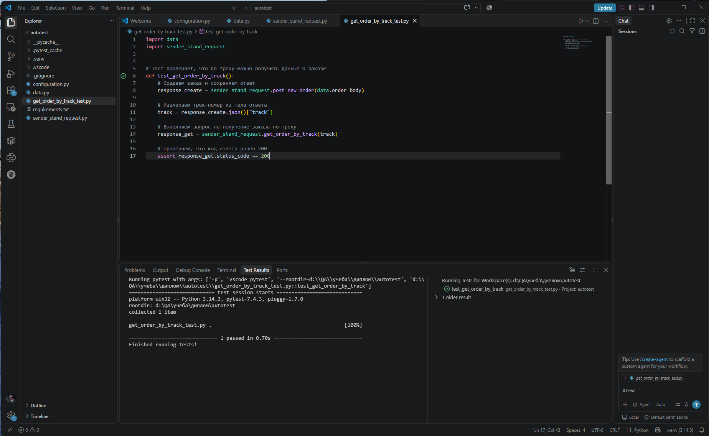

# Дипломный проект: Тестирование веб-приложения "Яндекс Самокат"

В данном репозитории собраны результаты дипломной работы по практическому блоку: вторая часть.

---

## 📊 Задание 1. Проверка отображения заказа в базе данных
Проверка корректности записи данных, созданных через API, напрямую в базу данных с помощью SQL-запросов. В ходе работы был обнаружен баг с дублированием заказов на уровне бэкенда.

* [Ссылка на подробный отчет по Заданию 1](./Task_2.1_Database.md)

## 🗂️ Задание 2. Проверка статусов заказов
Написание SQL-запроса с использованием оператора `CASE` для вычисления статусов заказов. Дополнительно была проведена проверка на логические аномалии (конфликты статусов).

* [Ссылка на подробный отчет по Заданию 2](./Task_2.2_Database.md)

---

## 🤖 Задание 3. Автоматизация теста к API

**Текст задания:**
Теперь автоматизируй сценарий, который подготовили коллеги-тестировщики:
Клиент создает заказ.
Проверяется, что по треку заказа можно получить данные о заказе.

Шаги автотеста:
1. Выполнить запрос на создание заказа.
2. Сохранить номер трека заказа.
3. Выполнить запрос на получение заказа по треку заказа.
4. Проверить, что код ответа равен 200.



### 🛠️ Используемые технологии
* Python 3.8+
* Pytest (фреймворк для запуска тестов)
* Requests (библиотека для работы с HTTP-запросами)

### 📁 Структура проекта автотестов
* `configuration.py` - содержит базовый URL-адрес сервера и пути к эндпоинтам API.
* `data.py` - хранит тестовые данные (тело запроса для создания заказа).
* `sender_stand_request.py` - содержит функции для отправки POST и GET запросов к API.
* `get_order_by_track_test.py` - непосредственно сам тест-кейс.
* `.gitignore` - скрывает системные файлы и кеш от попадания в репозиторий.
* `requirements.txt` - список необходимых зависимостей.

### 🚀 Инструкция по запуску
1. Установите зависимости:
```bash
pip install -r requirements.txt
```

2. Запустите тест с помощью Pytest:
```bash
pytest get_order_by_track_test.py
```

### 📝 Логирование
В случае возникновения ошибок при работе API, логи бэкенда находятся на сервере по следующему пути:
`/var/www/backend/logs/error.log`
