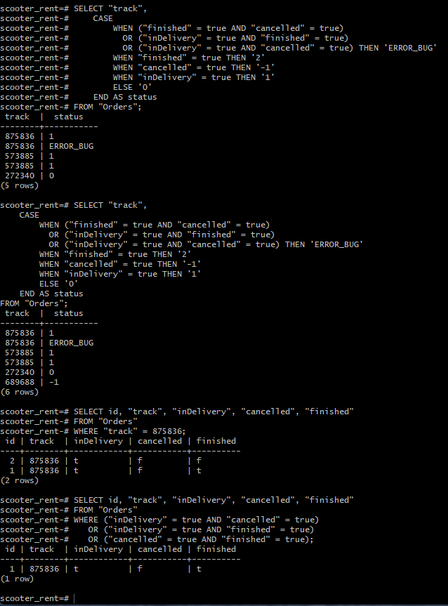

# Задание 2.2 Проверка статусов заказов в базе данных

**Постановка задачи:** Ты тестируешь статусы заказов. Нужно убедиться, что в базе данных они записываются корректно.
Для этого: выведи все трекеры заказов и их статусы. 
Статусы определяются по следующему правилу:
Если поле finished == true, то вывести статус 2.
Если поле canсelled == true, то вывести статус -1.
Если поле inDelivery == true, то вывести статус 1.
Для остальных случаев вывести 0.

**Цель:** Проверить корректность записи статусов заказов в базу данных при взаимодействии с API. Вывести трекеры и вычисленные статусы с помощью SQL-оператора `CASE`, а также проверить данные на логические аномалии.

**Инструменты:**
* Postman (для работы с API)
* Терминал (SSH)
* PostgreSQL (`psql`)

---

### Ход выполнения

**Шаг 1. Подготовка тестовых данных через API**
Для проверки всех веток условного оператора я создал 4 заказа через Postman и провел их через разные состояния:
1. **272340 (Обычный заказ, статус 0):** Создан через `POST /api/v1/orders`, никаких действий больше не применялось.
2. **573885 (В доставке, статус 1):** Создан, после чего успешно принят курьером через `PUT /api/v1/orders/accept/:id?courierId=...`.
3. **689686 (Отмененный, статус -1):** Создан и отменен через `PUT /api/v1/orders/cancel?track=...`.
4. **875836 (Завершенный, статус 2):** Создан, принят курьером, а затем успешно завершен через `PUT /api/v1/orders/finish/1` (где `1` — внутренний `id` заказа в базе).

**Шаг 2. Составление SQL-запроса с проверкой на аномалии**
По условию задачи статусы определяются по правилу: `finished` -> 2, `cancelled` -> -1, `inDelivery` -> 1, остальные -> 0. 

Я добавил в запрос проверку на логические баги на самый верх оператора `CASE`, приведя все возвращаемые значения к строковому типу:

```sql
SELECT "track",
    CASE
        WHEN ("finished" = true AND "cancelled" = true) 
          OR ("inDelivery" = true AND "finished" = true) 
          OR ("inDelivery" = true AND "cancelled" = true) THEN 'ERROR_BUG'
        
        WHEN "finished" = true THEN '2'
        WHEN "cancelled" = true THEN '-1'
        WHEN "inDelivery" = true THEN '1'
        ELSE '0'
    END AS status
FROM "Orders";
```

**Шаг 3. Результат выполнения запроса**
Запрос выявил критические аномалии в данных:
```text
 track  |  status
--------+-----------
 875836 | 1
 875836 | ERROR_BUG
 573885 | 1
 573885 | 1
 272340 | 0
 689686 | -1
(6 rows)
```

**Шаг 4. Локализация бага и анализ сырых данных**
Для понимания причин я выполнил выгрузку сырых флагов проблемного заказа:
```sql
SELECT id, "track", "inDelivery", "cancelled", "finished" 
FROM "Orders" 
WHERE "track" = 875836;
```
Результат показал, что в базе существует две записи с этим треком:
* `id=2`: `inDelivery = true`, `finished = false`
* `id=1`: `inDelivery = true`, `finished = true` (вызвало `ERROR_BUG`)

Запрос на поиск всех конфликтов подтвердил, что такая аномалия есть только у завершенного заказа:
```sql
SELECT id, "track", "inDelivery", "cancelled", "finished" 
FROM "Orders" 
WHERE ("inDelivery" = true AND "cancelled" = true) 
   OR ("inDelivery" = true AND "finished" = true) 
   OR ("cancelled" = true AND "finished" = true);
```



**Анализ этапов возникновения багов:**
1. **Создание (272340):** Баг не воспроизводится. Флаги корректны.
2. **Принятие (573885):** Бэкенд создает **дубликат записи** вместо обновления существующей. Обе записи получают `inDelivery = true`.
3. **Отмена (689686):** Баг не воспроизводится. Заказ корректно получает `cancelled = true` без дублей.
4. **Завершение (875836):** Баг усугубляется. При вызове ручки завершения `/api/v1/orders/finish/1` бэкенд обновляет только одну из дублированных записей (`id=1`), ставит ей `finished = true`, **но забывает снять `inDelivery = true`**. Вторая запись (`id=2`) остается висеть в доставке. Из-за одновременного нахождения `inDelivery` и `finished` в значении `true` наш запрос и выдал `ERROR_BUG`.

**Вывод:**
Сам SQL-запрос с оператором `CASE` работает корректно. Проверка выявила критические проблемы на стороне бэкенда:
1. **Дублирование записей** на этапе принятия заказа (`accept`).
2. **Некорректное обновление статусов** на этапе завершения (`finish`): не снимается старый флаг `inDelivery` и обновляется только одна запись из дублей.
Баг требует передачи разработчикам.
